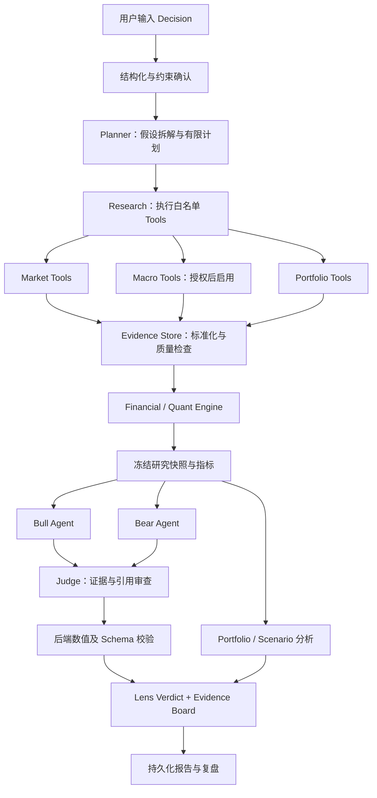
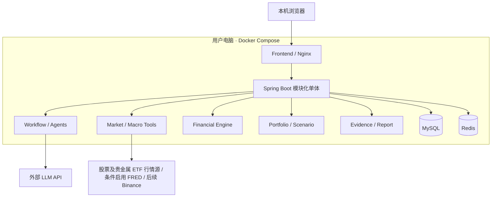

# InvestLens 黑客松项目设计与参赛文档

**AI Investment Decision Intelligence｜AI 投资决策研究 Agent**

| 项目项 | 约定 |
|---|---|
| 文档版本 | v1.1 · 2026-10-23 |
| 使用目的 | 产品设计、36h MVP 开发、参赛答辩、后续 PPT |
| 核心对象 | Decision / Hypothesis / Scenario |
| 技术路线 | Spring Boot + Vue + MySQL + Redis |
| 交付形态 | 用户电脑上的 Docker Compose 本地部署 |
| 文档状态 | 设计基线；功能、配置和接口均为待实现约定，不代表代码已交付 |
| 数据原则 | 真实来源、确定性计算、证据可追溯、缺失不编造 |
| MVP 边界 | 不接券商账户、不下单、不承诺收益、不实施 K8s 或微服务集群 |

v1.1 范围调整：按用户要求，默认研究股票与黄金、白银。首版演示暂用美元计价的美股与贵金属 ETF；ETF 明确标为代理资产，现货贵金属单独适配。具体市场和代码在行情能力探测后锁定，Crypto 不再作为默认路径。开发阶段顺序以《开发顺序与WealthFlow复用计划》为准，本文件第 18 章保留总体时间闸门。

> InvestLens 帮助用户把“我为什么准备这样投资”变成可以调研、计算、质疑和复盘的决策记录。
>
> 产品主张：**先检验证据与风险，再形成自己的投资判断。**

---

## 目录

1. 项目摘要与范围决策
2. 背景、痛点与目标用户
3. 产品定位、核心价值与差异
4. 领域模型与典型场景
5. 核心功能与页面设计
6. Agent 工作流与执行约束
7. Financial / Quant Engine
8. Evidence Store / Board 与可信机制
9. 系统架构与技术选型
10. 模块、目录与接口设计
11. 数据源、接入条件与 Tool 设计
12. 数据库与任务状态设计
13. Docker Compose 部署设计
14. 云原生演进与技术取舍
15. 异常处理、容错与恢复
16. 成本、性能与可观测性
17. 安全、隐私与产品边界
18. 36h MVP 开发计划
19. 验收标准与验证方案
20. 三分钟 Demo 脚本
21. 评分维度与展示策略
22. 风险清单与后续迭代
23. PPT 提纲与答辩话术
24. 官方资料与待确认事项

---

## 1. 项目摘要与范围决策

### 1.1 一句话介绍

InvestLens 是一个围绕投资决策展开的 AI 研究工作台：用户输入投资计划与理由，系统调用市场、宏观与持仓工具收集证据，通过确定性的金融引擎计算风险，再由 Bull、Bear、Judge 三种角色形成有依据、有反证、有适用条件的 Lens Verdict。

### 1.2 核心闭环

**投资想法 → 结构化假设 → 调研计划 → 真实数据 → 确定性计算 → 多空审查 → 条件化结论 → 组合与情景对比 → 保存复盘。**

交付物是一份可追溯的 Decision Report，包含：

- 用户决策、投资期限、资金来源、风险约束；
- 每条假设的支持证据、反对证据与尚未验证的部分；
- 已使用的数据时间、来源、市场、币种和缺失项；
- Financial Engine 的指标、公式版本与计算输入；
- 对当前组合的影响、情景假设和结果；
- Lens Verdict、关键风险、失效条件与下一步需要补充的信息。

### 1.3 已确定的技术取舍

| 决策 | 36h MVP 方案 | 原因 |
|---|---|---|
| 后端形态 | 一个 Spring Boot 应用，内部模块化 | 降低开发与联调成本，保留拆分边界 |
| 前端 | Vue + TypeScript，组件库与图表库按团队熟悉度选择 | 优先完整研究界面 |
| 持久化 | MySQL 存事实与任务状态；Redis 做缓存和限流 | 确保记录可恢复，避免只存在模型上下文中 |
| 部署 | Docker Compose：frontend、backend、mysql、redis | 无需云服务器，可在用户电脑复现 |
| 模型角色 | 同一个模型的不同角色调用，非多个独立服务 | 多 Agent 的价值来自职责和证据约束 |
| 金融计算 | Java 中实现有限、清晰、可测试的计算 | 避免增加 Python 服务与跨语言部署负担 |
| 数据接入 | 股票/ETF 源优先验证 Twelve Data 或其他获准来源；FRED 条件启用；Binance 后续扩展 | 先完成股票或贵金属 ETF 的真实数据闭环 |
| 云原生 | 写出演进设计，不在 MVP 实施 K8s | 将时间投入 Agent、金融引擎与 Demo |
| 新闻 | MVP 不依赖新闻 API 或全网爬虫 | 避免增加授权、噪声与检索复杂度 |

### 1.4 最小可交付成果

以“现金转为黄金 ETF 或股票仓位”的场景完成一条端到端路径，至少具有真实历史行情、证据卡片、收益/波动/回撤计算、Bull/Bear 观点、Judge 结论、组合权重变化、资产价格冲击情景及本地部署。P0 标的白名单覆盖经验证的股票及黄金、白银 ETF，不要求覆盖整个市场。

黄金、白银的行情与风险分析属于默认范围；“降息利好黄金”的宏观因果检验仍是扩展能力，不能因行情接通就宣称论点成立。贵金属现货、完整宏观因果检验、全资产回测、自动交易不进入首版必做清单。

## 2. 背景、痛点与目标用户

### 2.1 项目背景

个人投资者经常从新闻、社交媒体或市场叙事中产生投资想法，例如“降息可能利好黄金”“看好 AI，所以继续加仓科技资产”。问题通常不在于缺少观点，而在于难以把观点连接到可核查的数据、明确的计算口径和自身组合风险。

InvestLens 面向这一环节，将分散的信息和工具组织为一次可以保存和复盘的研究任务。

### 2.2 主要痛点

| 痛点 | 常见表现 | 产品回应 |
|---|---|---|
| 理由模糊 | 只说“看好”，未说明期限或验证条件 | 将输入拆为 Decision 和 Hypothesis |
| 数值不可信 | 模型给出看似精确、却无来源的收益或价格 | 所有金融数值来自 Tool 或 Engine |
| 确认偏误 | 只搜索支持自己观点的材料 | 强制生成支持、反对与缺失证据 |
| 缺少组合视角 | 只研究一个标的，不看已有风险暴露 | 展示持仓权重与资金来源前后对比 |
| 结论难复核 | 无法知道某句话基于哪组数据 | Claim → Evidence → 数据/计算记录 |
| 无法复盘 | 分析散落在聊天窗口 | 保存不可变的决策与研究版本 |

### 2.3 目标用户

**首要用户：**具备基础投资知识、愿意主动研究的个人投资者，以及希望学习投资研究方法的学生和金融科技爱好者。

**次要用户：**需要快速整理投资论点、检查反证和风险的研究助理。机构级工作流属于后续方向，不是 MVP 服务承诺。

MVP 暂不覆盖高频交易、衍生品定价、杠杆保证金、机构合规审批或跨账户实盘管理。

## 3. 产品定位、核心价值与差异

### 3.1 产品定位

- 英文定位：**AI Investment Decision Intelligence**。
- 中文定位：**AI 投资决策研究 Agent**。
- 核心交互：一个 Decision、一组 Hypothesis、多个可调整的 Scenario。
- 输出形式：有证据约束的研究报告和风险对照，而非直接生成买卖指令。
- 用户主导：系统辅助核查理由与风险，最终决策由用户作出。

### 3.2 核心价值

1. **把模糊观点变成可研究的问题。**明确标的、期限、资金来源、假设和风险约束。
2. **让研究有数据依据。**展示来源和观察时间，对缺失、延迟、代理资产明确标注。
3. **让计算可以重跑。**相同输入快照与引擎版本得到相同数值结果。
4. **主动寻找反证。**让多空观点围绕同一证据集展开。
5. **回到用户组合。**量化“加仓后改变了什么”，并展示假设冲击下的损失。

### 3.3 与普通 AI 问答的差异

| 维度 | 常见金融问答 | InvestLens 的设计要求 |
|---|---|---|
| 输入单位 | 一个问题 | 一个可持久化的 Decision |
| 处理过程 | 文本生成 | 有边界的任务规划、工具调用与审查 |
| 金融数字 | 可能来自模型记忆或概括 | 后端工具和计算结果，绑定 ID |
| 证据 | 链接或口头解释 | 来源、时间、口径、质量与计算链 |
| 观点组织 | 一段综合回答 | 支持 / 反对 / 未验证并列 |
| 风险 | 泛化提示 | 仓位、样本指标、冲击损失与约束对比 |
| 输出 | 建议文本 | Verdict + Evidence Board + Metric Panel |
| 复现 | 对话难以稳定复现 | 快照、公式版本、Prompt 版本可追踪 |
| 失败处理 | 可能继续补全文本 | 数据不足、部分完成或明确拒绝计算 |

差异不来自角色名称数量，而来自“数据进入、数值生成、结论引用、失败降级”的系统约束。

## 4. 领域模型与典型场景

### 4.1 三个核心对象

| 对象 | 定义 | 关键字段 |
|---|---|---|
| Decision | 用户准备采取的配置变化与约束 | action、asset、allocation、funding、horizon、baseCurrency、constraints |
| Hypothesis | 可以被证据支持、反驳或暂时无法判断的论点 | statement、mechanism、testMethod、evidenceIds、status |
| Scenario | 一组明确的假设条件及其计算结果 | shockInputs、portfolioSnapshotId、assumptions、metricIds |

示例：“将组合中 10 个百分点的现金转为黄金 ETF，持有约六个月，因为我认为宽松环境可能有利于黄金；希望理解下跌风险。”

这里的“10 个百分点”是组合权重变化；不是相对原黄金 ETF 仓位增长 10%。表单和 API 必须区分两者。六个月是研究期限，不构成未来六个月的收益预测。

### 4.2 场景 A：新增黄金 ETF 仓位，检查风险是否可承受

输入一个示例组合：黄金 ETF 20%、白银 ETF 10%、现金 70%；用户计划用现金增加 10 个百分点黄金 ETF。股票增配复用同一工作流。

系统过程：

1. 确认计价币、研究时间窗与现金来源；
2. 从已验证的股票/ETF 行情源获取黄金 ETF、白银 ETF 的已完成交易日 K，记录复权、交易所和时区；
3. 计算两个资产的样本累计收益、年化波动率、最大回撤；
4. 展示黄金 ETF 权重从 20% 到 30%、现金从 70% 到 60%；
5. 对“黄金 ETF 下跌 20%、白银 ETF 下跌 25%、现金收益为零”的人工设定情景进行重估；
6. Bull 解释论点的可支持部分，Bear 指出集中风险和未验证的宏观理由；
7. Judge 将“历史事实”“用户假设”“推断”和“未知项”分开呈现。

上述权重和冲击只是演示算术输入，不代表当前市场、典型波动或未来预测。首版暂采用美元计价、同交易市场的股票/ETF 与美元现金，不混入缺少汇率的其他币种。黄金/白银 ETF 不等于现货；未来接入现货时另存报价单位、交易时段和日历，不静默混算。

### 4.3 场景 B：认为降息利好黄金，检验论点

Decision：将部分现金配置到黄金相关资产。Hypothesis：利率变化与该资产价格表现存在有利关系。

系统应先拆出三件事：政策利率是否发生变化、历史事件窗口中价格如何表现、当前组合是否增加集中风险。黄金 ETF 只能作为代理资产，需说明它与黄金现货的费用、跟踪、交易时段和币种差异。

该场景中的黄金资产行情和风险分析属于 P0；宏观因果检验属于条件启用的扩展能力。数据授权、样本长度和宏观发布时点不足时，仅对宏观论点展示研究计划与缺口，不输出“降息必然带来上涨”或未经验证的胜率。

### 4.4 场景 C：组合看似分散，实际风险集中

用户持有多只科技股或相关 ETF，计划继续增加其中一个标的。系统首先检查可见的资产权重、历史收益相关性和新增配置后的集中度。

MVP 仅能报告标的级集中度与样本相关性；未接入基金成分数据时，不宣称完成穿透持仓分析。没有共同样本时，相关性返回不可计算。

## 5. 核心功能与页面设计

### 5.1 功能优先级

| 功能 | 级别 | MVP 交付口径 |
|---|---|---|
| 决策输入与确认 | P0 | 文本 + 表单，确认标的、资金来源、权重、期限 |
| Planner / Research | P0 | 有限步骤、白名单 Tool、进度可见 |
| Market Tool | P0 | 股票及黄金/白银 ETF 的报价、已完成交易日 K、交易日历与复权元数据 |
| Evidence Store / Board | P0 | 证据卡、质量标签、引用跳转 |
| Financial Engine | P0 | 累计收益、波动率、最大回撤 |
| Bull / Bear / Judge | P0 | 同证据集、结构化输出、一次多空审查 |
| Portfolio / Scenario | P0 简版 | 手动权重、调仓前后与价格冲击计算 |
| 历史记录 | P0 | 保存 Decision、Run 与报告，刷新后可查看 |
| Docker Compose | P0 | 四容器、健康检查、卷和配置说明 |
| 股票 / 贵金属 ETF 数据 | P0 | 优先验证 Twelve Data 或其他获准来源，按实际能力限制标的 |
| 贵金属现货 / Crypto 数据 | P1 | 独立适配报价单位、日历与权限；不作为默认演示路径 |
| Macro Tool | P1 | 接口预留；授权未解决则返回不可用 |
| 历史相关性、组合历史风险 | P1 | 共同日历与样本质量通过才计算 |
| 宏观事件研究 | P2 | 更长样本、发布时点与版本支持 |
| 自动交易、券商接入、K8s | 不做 | 后续另立需求和风险评审 |

### 5.2 页面组织

**Lens Lab：**决策输入、预设场景、持仓权重、约束确认。自然语言提取结果必须可编辑，模型不能擅自把缺失信息当作用户授权。

**Research Workspace：**顶部展示 Decision 摘要与状态；中部展示计划和已完成步骤；侧边 Evidence Board；主面板依次展示 Metrics、Bull/Bear 与 Lens Verdict。

**Portfolio X-Ray：**标的权重、现金来源、集中度、调仓前后对比；Scenario 区用滑块或输入框修改冲击，后端直接重算。

**History：**按 Decision 查看历史 Run、输入版本、数据时间与报告；旧结果不被新运行覆盖。

### 5.3 体验要求

- 首屏让用户看懂“正在验证哪条投资理由”，进度文案反映真实步骤。
- 数据卡统一显示 provider、asOf、retrievedAt、币种和状态。
- 历史行情使用折线，样本风险使用指标卡；不可计算显示原因，不显示零。
- 点击结论中的证据编号可以定位原始证据与计算说明。
- Scenario 的假设标签始终可见，结果变化由计算服务驱动。
- 缓存、历史快照、模拟数据具有持续可见的标识。
- 界面不展示 API Key、内部 Prompt 或不必要的部署实现细节。


## 6. Agent 工作流与执行约束

### 6.1 工作流总图



宏观证据缺失时仍可完成市场和组合风险分析，但相关宏观假设必须标为“未验证”。Evidence Board 是 Store 的用户可视化视图，不是另一个数据事实源。

### 6.2 各角色职责与契约

| 角色 / 阶段 | 输入 | 输出 | 禁止事项 |
|---|---|---|---|
| 输入解析 | 用户原文、表单 | DecisionDraft、缺失项 | 擅自推断资金规模或风险承受能力 |
| Planner | 已确认 Decision、Tool 能力清单 | Hypothesis 列表、有限 DAG、数据需求 | 生成任意 URL 或执行代码 |
| Research | 计划、预算、资产白名单 | Tool 结果、证据与失败原因 | 用模型记忆补行情 |
| Bull | 同一快照、假设、指标 | 有利论据与成立条件 | 伪造支持证据 |
| Bear | 同一快照、假设、指标 | 反证、风险和失效条件 | 为了对称而捏造反证 |
| Judge | 多空输出、证据、数据质量 | Verdict、分歧、未知与后续验证 | 以多数投票代替证据 |
| Output Validator | 结构化报告、全部引用 | 可发布报告或错误 | 放过不存在的引用和金融数字 |

MVP 可将“解析 + Planner”合并为一次模型调用；Research 使用后端编排器执行工具，避免为每个取数动作都增加 LLM 调用。

### 6.3 有界执行

建议初始预算：单任务最多 3 个标的、每标的 1 个历史窗口、最多 8 次外部数据调用、模型正常路径 4 次调用（Plan、Bull、Bear、Judge），Schema 修复最多 1 次。超预算返回明确缺口或部分报告。

工作流顺序由后端控制。Bull/Bear 可并发，但受同一账户的模型限流约束；Judge 必须等待两者完成或明确超时。只进行一轮审查，不做无限辩论和自我递归。

Tool 入参经 JSON Schema 和业务校验，Tool 名称、数据源、资产、区间均白名单化。文本中的指令不能修改系统权限、预算和工具配置。

### 6.4 Lens Verdict 结构

```json
{
  "runId": "run_demo",
  "verdict": "INSUFFICIENT_EVIDENCE",
  "thesisAssessment": "宏观理由尚未验证，已完成市场风险分析",
  "supportingClaims": [
    {
      "claimId": "c1",
      "text": "新增配置提高了目标资产的组合占比",
      "evidenceIds": ["E_PORTFOLIO_01"],
      "metricRefs": ["M_WEIGHT_CHANGE"]
    }
  ],
  "opposingClaims": [],
  "unknowns": ["缺少获准使用的宏观数据"],
  "invalidationConditions": ["用户更改资金来源或风险约束"],
  "nextChecks": ["补充可用的宏观证据"],
  "dataQuality": "PARTIAL",
  "dataSnapshotId": "snapshot_demo",
  "limitations": ["情景结果不代表未来预测"]
}
```

示例只说明数据结构，不包含实际研究结论。正式状态枚举为 SUPPORTED / MIXED / NOT_SUPPORTED / INSUFFICIENT_EVIDENCE，分别表示证据支持程度，不对应买入、持有或卖出指令。

MVP 不显示“上涨概率 87%”之类未经校准的数字，也不把模型自评的 confidence 当作统计置信度。以证据覆盖情况、样本长度、时效性和数据缺口帮助用户理解可靠程度。

## 7. Financial / Quant Engine

### 7.1 职责与边界

Financial Engine 是后端的确定性计算模块。LLM 负责提出研究问题、组织论点和解释已计算结果；引擎负责价格处理、收益、波动、回撤、相关性、组合估值与情景冲击。

每个计算输出必须包含 metricId、输入快照、公式版本、参数、单位、样本窗口、样本数量与质量标记。输入不足返回不可计算，不生成“合理估计”。

MVP 不实现策略寻优、复杂 Monte Carlo、期权 Greeks、杠杆清算或自动资产配置优化。

### 7.2 数据预处理约定

1. 资产唯一键至少包含资产类别、交易所/数据源、symbol 和 quoteCurrency，避免同名代码碰撞。
2. 时间戳以 UTC 保存；展示使用用户时区；股票另存交易所时区与 sessionDate。
3. 默认只使用已闭合日 K，未闭合 K 不参与完整日收益计算。
4. 日历、币种、频率和复权口径一致后才能做跨资产统计。
5. 价格缺失不填零；默认不对市场收益序列前向填充。共同样本不足则拒绝计算。
6. 股票必须记录 adjusted/unadjusted 及其含义。只有未复权价格时标为价格收益，不冒称包含分红的总收益；遇拆股窗口须处理或禁算。
7. FRED 等低频宏观序列不能直接当作交易日价格。若启用，按实际可知的发布日期对齐，不能把后来公布的数值提前用于回测。
8. 金额和权重使用 BigDecimal；统计函数可用 double，舍入仅在展示层统一处理。

### 7.3 指标公式与显示规则

设 P_t 为同口径价格，T 为期间数量。

| 指标 | 公式 / 方法 | 必要说明 |
|---|---|---|
| 简单期间收益 | r_t = P_t / P_(t-1) − 1 | P_(t-1) 必须大于零 |
| 区间累计收益 | R = P_T / P_0 − 1 | 使用同一币种与价格口径 |
| 年化波动率 | vol = stdev_sample(r_t) × sqrt(A) | 样本标准差；A 是年化因子 |
| 最大回撤 | MDD = max_t[1 − V_t / max_(s≤t)(V_s)] | 以非负损失幅度展示 |
| Pearson 相关系数 | corr(x,y) = cov(x,y)/(sd(x)sd(y)) | 共同时间窗；零方差不可算 |
| 当前权重 | w_i = value_i / sum(value) | 含现金；基准币种一致 |
| 单期冲击损益 | PnL = sum(value_i × shock_i) | 无杠杆、无资金进出时成立 |
| 组合冲击收益 | R_p = sum(w_i × shock_i) | 冲击是输入假设，不是概率 |
| 年化收益（扩展） | (V_T/V_0)^(365/days) − 1 | 不对短样本制造长期收益暗示 |
| 组合波动（扩展） | sqrt(wᵀΣw) × sqrt(A) | 收益、协方差、权重与日历一致 |

A 的默认约定：P0 股票与贵金属 ETF 的交易日样本使用 252；后续同一 Crypto 日历可使用 365。贵金属现货按来源与采样日历单独配置，不因“黄金/白银”名称就套用 ETF 日历。这是配置约定，不是所有市场的通用事实；跨日历组合不能混用年化因子，MVP 仅对共同日历和质量检查通过的样本计算组合历史风险。

建议波动率至少 30 个有效收益样本、相关性至少 60 个共同收益样本；这是产品质量阈值，可配置，并不意味着统计显著或预测有效。样本不足展示原因和实际样本数。

### 7.4 Portfolio 计算口径

MVP 用户手工输入权重，默认无杠杆，权重非负且合计 100%。新增仓位必须指定资金来源，例如减少现金；外部新增资金时，需先改变组合总价值再归一化权重。

**当前风险：**基于当前市值快照计算权重、标的集中度与情景损失。

**历史比较：**若 P1 实现，区分以下两种假设：

- 买入并持有：初始权重确定持有数量，后续权重随价格漂移；
- 定期再平衡：按明示频率恢复目标权重，扣除配置的手续费和滑点。

不能把“每天用当前固定权重加权历史收益”标为买入并持有，也不能用今天的组合表现假装用户过去真实持有。只有权重而无交易流水时，显示“基于当前配置的历史假设分析”。

现金默认冲击为零，仅表示模型假设；不代表任何现金产品无风险或有真实零利率收益。

### 7.5 Scenario Lab

P0 实现**资产价格直接冲击**：用户输入各资产的涨跌幅，后端用同一快照立即重估。允许在不调用 LLM 的情况下反复修改参数。

例如对总值 100 个计价单位的示例组合，黄金 ETF 20、白银 ETF 10、现金 70：

- 输入冲击：黄金 ETF −20%、白银 ETF −25%、现金 0%；
- 原组合损益：20×(−20%) + 10×(−25%) = −6.5；
- 黄金 ETF 增至 30、白银 ETF 10、现金 60 后：30×(−20%) + 10×(−25%) = −8.5；
- 新增配置使该假设情景损失增加 2 个计价单位。

以上是可验证的算术示例，既非历史真实表现，也非未来预测。若用户输入绝对组合金额，则按金额等比例计算。

P2 才讨论“利率下降 50bp 对资产价格的影响”。利率冲击与资产收益之间必须有明确模型或用户假设；没有可靠映射时，不允许由 LLM 凭空生成价格反应。bp 与百分比必须区分，50bp = 0.5 个百分点。

### 7.6 历史假设检验与回测边界

历史相关性仅是描述统计，不说明因果。宏观事件研究须明示事件定义、发布日期、持有窗口、样本数量、重叠窗口和混杂因素；相邻月份同一降息周期不能自动当作独立样本。

没有当时可得的宏观版本时，只能称“使用当前版本数据的事后描述”，不能称无前视偏差回测。正式策略回测另需交易时点、价格口径、成本、再平衡规则与样本外验证。

## 8. Evidence Store / Board 与可信机制

### 8.1 四类证据

| 类型 | 例子 | 作用 |
|---|---|---|
| SOURCE_FACT | 某数据源的已闭合日 K、宏观观察值 | 外部事实 |
| USER_INPUT | 用户资金来源、持仓、情景冲击 | 用户设定，非市场事实 |
| COMPUTED | 收益、波动率、回撤、冲击损益 | 可追溯计算 |
| INTERPRETATION | Bull/Bear 对证据的解释 | 推断，不冒充事实 |

每个证据具有不可变 ID；单次运行可显示 E01 等短编号，数据库使用全局 ID，避免跨 Run 引错。

### 8.2 最小证据结构

```json
{
  "id": "ev_global_id",
  "runId": "run_demo",
  "displayId": "E01",
  "type": "SOURCE_FACT",
  "provider": "<approved_equity_provider>",
  "sourceUrl": "<approved_provider_endpoint_without_credentials>",
  "instrumentId": "ETF:<exchange>:<gold_etf_symbol>:USD",
  "quoteCurrency": "USD",
  "instrumentType": "ETF",
  "priceUnit": "USD_PER_SHARE",
  "adjustment": "<verified_price_adjustment>",
  "exchangeTimezone": "<exchange_timezone>",
  "interval": "1d",
  "asOf": "<last_closed_candle_time>",
  "retrievedAt": "<utc_retrieval_time>",
  "quality": "VALID",
  "dataMode": "LIVE",
  "payloadHash": "<sha256>",
  "storagePolicy": "PROVIDER_SPECIFIC",
  "payloadRef": "<authorized_snapshot_reference>"
}
```

该对象是结构示意，尖括号内容为占位符。sourceUrl 不含 Key、签名或账户信息。是否可保存 payload 由数据源授权决定，不因采用 Evidence Store 就默认允许永久保存。

### 8.3 数据与数值校验链

**Tool 响应 → 数据校验 → Evidence 快照 → Engine 指标 → 冻结 Evidence Bundle → Agent 引用 → 后端校验 → 展示。**

金融数字采用引用渲染：Agent 输出 metricRef，例如 M_VOL_GOLD_ETF；后端查找已批准的指标值并格式化显示。用户输入数值绑定 USER_INPUT 证据。不要只靠 Prompt 要求“不要编造”。

P0 的强制规则：

1. 每个外部事实声明必须引用有效证据；无引用的观点只能标为假设或一般性解释。
2. 所有价格、金融指标、权重与情景损益均由前端从后端结构化字段渲染。
3. Agent 的自由文本字段不得新增金融数字；按字段白名单校验、检测未授权数字，必要时修复一次，仍失败则移除该段。
4. 引用 ID 必须属于当前 Run 的冻结快照；不能引用不存在、未获准使用或已过期的证据。
5. 引用存在不代表论证正确：Judge 检查方向、区间、口径是否支持声明；高风险冲突应暴露给用户。
6. 空值、数据不足、授权禁用和源故障在报告中有明确状态。

### 8.4 质量与时效标签

证据质量建议使用 VALID / STALE / MISSING / CONFLICT / INVALID / LICENSE_BLOCKED；数据模式单列 LIVE / CACHE / REPLAY / SYNTHETIC，不将这些概念混为同一状态。

时效按数据类型评估：闭市后的最近交易日价格不自动算坏数据；月度宏观观察期不等于发布日期；抓取时间也不等于最新观察时间。

来源冲突时保留双方及口径，MVP 不做跨源静默拼接。缓存使用时显示原 asOf 与 retrievedAt，不把读取缓存的时间伪装成市场时间。

### 8.5 防止“多 Agent 一起犯错”

Bull/Bear 使用同一冻结快照、不同审查任务，不互相追加未经核实的数据。Judge 输出事实争议、解释争议、缺失证据；不按文风、字数或多数票裁决。

角色划分能改善审查结构，但不等于观点独立，也不能消除共享模型偏差。报告应允许得出“证据不足”，而不是强制产出方向性结论。


## 9. 系统架构与技术选型

### 9.1 MVP 实际架构



图中的 Agent、Tool、Engine 是 Spring Boot 内部模块，不是独立容器。部署采用四个业务依赖容器，不新增服务注册中心、API Gateway、消息集群或分布式配置中心。

**本地部署不等于完全离线。**在线调研依赖网络和外部 API，模型推理也可能向外部服务发送数据。离线模式仅提供明确标记的回放或合成样例。

### 9.2 技术建议

| 层 | 选择 | 使用范围 |
|---|---|---|
| 运行时 | Java 17、Spring Boot 4.0.9、Maven Wrapper | 按用户最终生成的骨架锁定，避免比赛中升级 |
| Web | Spring MVC + SSE | REST 创建任务，SSE 推送进度 |
| 模型适配 | 一个 LlmClient 接口 | 使用供应商 SDK 或 HTTP，避免多套框架并存 |
| 持久层 | MyBatis Starter 4.0.1 | 已在骨架加入主依赖和测试 Starter；旧 Boot 3 代码须适配 |
| 数据库迁移 | Flyway | 初始化表和可重复升级 |
| 数据库 | MySQL 8.4 系列，镜像版本锁定 | 业务事实、报告与任务状态 |
| 缓存 | Redis，选择已确认许可的固定版本 | 缓存、限流、短期事件 |
| 前端 | Vue 3 + TypeScript + Vite | 工作台与图表 |
| 运维 | Actuator + 结构化日志 | 健康检查、指标和故障定位 |
| 测试 | JUnit + Provider fixture / stub | 核心公式、数据适配与流程失败 |

这些是实现建议，不是必须同时引入的技术清单；模型编排框架仅在团队已熟悉时使用，状态和安全边界仍由后端掌握。

### 9.3 模块间边界

Decision 负责输入和版本；Workflow 负责执行顺序与预算；Tool 负责访问外部源；Evidence 负责来源、质量和授权；Quant 只消费标准化输入，不发网络请求；Agent 只消费获准的证据；Report 负责校验和展示 DTO。

禁止 Controller 直接请求金融 API，也禁止 Quant 模块内部偷偷更换数据源或补默认市场价格。

## 10. 模块、目录与接口设计

### 10.1 后端模块

| 模块 | 主要职责 | 关键对象 |
|---|---|---|
| decision | 决策草稿、确认、版本 | Decision、Hypothesis |
| workflow | Run、Step、预算、事件 | ResearchRun、RunStep |
| agent | Planner、Bull、Bear、Judge | AgentInput、Claim、Verdict |
| tool | Market、Macro、Portfolio 适配 | ToolRequest、ToolResult |
| market | 标的、行情标准化、交易日历 | Instrument、Quote、Candle |
| quant | 公式、样本质量、组合计算 | Metric、CalculationManifest |
| portfolio | 手工持仓与快照 | Portfolio、Position、Snapshot |
| scenario | 冲击参数与对比 | Scenario、ScenarioResult |
| evidence | 证据存储、授权策略、引用 | Evidence、EvidenceLink |
| report | 报告校验、查询 | DecisionReport |
| infrastructure | DB、Redis、HTTP、模型配置 | Client、Repository、Limiter |

### 10.2 建议项目目录

```text
InvestLens/
├─ README.md
├─ docs/
│  └─ InvestLens-项目设计文档.md
├─ backend/
│  ├─ pom.xml
│  └─ src/main/
│     ├─ java/.../investlens/
│     │  ├─ decision/
│     │  ├─ workflow/
│     │  ├─ agent/
│     │  ├─ tool/
│     │  ├─ market/
│     │  ├─ quant/
│     │  ├─ portfolio/
│     │  ├─ scenario/
│     │  ├─ evidence/
│     │  ├─ report/
│     │  └─ infrastructure/
│     └─ resources/db/migration/
├─ frontend/
├─ deploy/
│  ├─ nginx.conf
│  └─ fixtures/     # 仅放获准回放或自建合成数据
├─ compose.yaml
├─ .env.example
└─ .gitignore
```

这是后续代码布局建议。本次交付为文档，不代表上述代码目录或部署文件已经实现。

### 10.3 REST 与进度接口

| 方法 / 路径 | 用途 | 关键行为 |
|---|---|---|
| POST /api/decisions | 保存草稿 | 返回 decisionId 与 version |
| PATCH /api/decisions/{id} | 修订草稿 | 乐观锁，不能改写已运行版本 |
| POST /api/decisions/{id}/runs | 创建研究 | 返回 202 与 runId；支持 Idempotency-Key |
| GET /api/runs/{id} | 查询状态 | 返回阶段、错误和数据质量 |
| GET /api/runs/{id}/events | SSE 进度 | 支持事件 ID 与断线补读 |
| GET /api/runs/{id}/report | 查询报告 | 运行未结束时返回明确状态 |
| GET /api/runs/{id}/evidence | 查询证据 | 根据授权过滤 payload |
| POST /api/runs/{id}/cancel | 取消任务 | 幂等；无法召回已发出的外部请求 |
| POST /api/portfolios | 创建手动组合 | 校验权重、币种和来源 |
| POST /api/scenarios | 重算情景 | 绑定快照版本；P0 不调用 LLM |
| GET /api/decisions | 历史列表 | 分页，不泄露 Key 或原始密钥参数 |

SSE 事件包含 eventId、runId、step、status、occurredAt 与面向用户的摘要。客户端只能展示实际发生的阶段，不模拟虚假工具调用。SSE 连接断开不会取消后台任务；可退化为状态轮询。

### 10.4 Tool 与 Engine 接口

```java
interface MarketDataProvider {
    ProviderCapabilities capabilities();
    QuoteResult getQuote(QuoteRequest request);
    CandleSeriesResult getCandles(CandleRequest request);
}

interface MacroDataProvider {
    MacroSeriesResult getSeries(MacroSeriesRequest request);
}

interface FinancialEngine {
    MetricBundle calculate(MetricRequest request);
    ScenarioResult stress(ScenarioRequest request);
}
```

统一 ToolResult 至少包含 status、data、provider、sourceRef、asOf、retrievedAt、qualityFlags、dataMode、errorCode、retryable、requestId。禁止使用空列表同时表达“成功但无数据”“请求失败”和“授权不允许”。

## 11. 数据源、接入条件与 Tool 设计

### 11.1 初步数据源组合与现实约束

默认方案改为 **股票与黄金/白银 ETF 行情源 + 条件启用的宏观源**。Twelve Data 是首个待验证候选，也可替换为其他获准来源；Binance 仅为后续 Crypto 适配候选。“可访问、免费额度、可展示、可缓存、可送入模型”是不同权限，需要逐项确认。以下条款信息沿用 v1.0 的核验记录，本次调整范围未重新联网核验，不代表已选定可用供应商。

截至 2026-10-23 核验：

| 来源 | 设计用途 | 接入条件与限制 |
|---|---|---|
| Twelve Data 或其他获准股票/ETF 源 | P0 股票及黄金/白银 ETF 行情 | Twelve Data 原核验记录为 Basic 8 credits/min、800/day；需重新确认目标标的、历史长度、复权、交易日历和使用权限，不预设免费方案适用 |
| 贵金属现货源 | P1 黄金/白银现货 | 独立验证 instrument、报价币种/单位、交易时段、展示与存储权限，不将 ETF 行情当作现货 |
| Binance | 后续 Crypto 报价与历史 K 线 | 按官方产品接口处理请求权重、限流与地域可用性；不申请交易权限 |
| FRED | 利率、CPI、国债收益率等候选 | API 需要 Key；当前条款含 AI 开发/训练以及缓存存储限制，不能默认接入现有 Agent / Evidence Store |
| 用户自建或获授权数据 | 样例与宏观替代输入 | 标明来源和权利；从受限源导出的文件不能靠改成 CSV 绕过限制 |

Binance 存在产品和端点级权重限制，应配置退避及连接监测，不将某个固定限额写死成永久值。参考：[Binance 官方 API 文档](https://developers.binance.com/en/docs/introduction)。

Twelve Data Basic 的额度按 credits 而非简单请求次数计量；多标的和高权重端点会额外消耗。参考：[官方个人套餐](https://twelvedata.com/pricing)。其 Basic 页面列为 internal non-display，用于公开 Evidence Board 展示不能仅凭免费账户推定获准；显示、分发和缓存需按具体合同确认。参考：[官方使用条款](https://twelvedata.com/terms)。

FRED 接入须按以下方式处理：保留 MacroDataProvider 和候选映射，默认 FRED_ENABLED=false；在获得覆盖 AI 使用及所需存储方式的明确许可，或改用经过核实的授权来源前，不将 FRED 内容输入模型或写入证据缓存。当前条款的相关禁止项见 API 条款 (k)、(l)。这项设计约束来自条款核验，不能以“只做推理”“数据公开”“个人 Key”自动豁免。参考：[FRED 服务及 API 条款](https://fred.stlouisfed.org/legal/)、[API Key 说明](https://fred.stlouisfed.org/docs/api/api_key.html)。

### 11.2 MVP 的可执行数据路线

1. 第 0—2 小时确认股票/ETF 候选源的连通性、目标标的、历史长度、复权、交易日历及演示使用权限；首版暂用美元计价的美股与贵金属 ETF。
2. 先以股票或黄金/白银 ETF + 现金完成真实数据研究；宏观理由可以保留为待验证假设。休市不补零，遇公司行动不静默计算，ETF 不冒充现货。
3. Twelve Data 或其他候选源先做能力探测，获准的端点才进入白名单；无法确认适用权限时换源或明确报告阻塞，不自动切回 Crypto。
4. FRED 不作为 P0 完成的前置条件。默认返回 LICENSE_BLOCKED，并在报告列出宏观证据缺失。
5. 回放只能使用允许缓存及展示的快照；无此权限则采用明确标记的自建合成数据，仅验证流程和公式，不充当真实投资证据。

因此不承诺“所有金融数据零成本、所有场景实时可用”。数据订阅可能从免费开始，LLM 费用和必要授权另计。

### 11.3 Tool 清单与最小能力

| Tool | 入参 | 输出 | MVP |
|---|---|---|---|
| Market.getQuote | instrumentId | price、币种、asOf | P0 |
| Market.getCandles | instrumentId、interval、start、end | 标准化已闭合 OHLCV | P0 |
| Market.getAssetInfo | symbol、market | 币种、交易状态、交易所 | P0 最小元数据 |
| Macro.getSeries | seriesId、window、vintage | 观察值、单位、频率、可知时间 | P1 条件启用 |
| Portfolio.getSnapshot | portfolioId、version | 权重/市值与资金来源 | P0 |
| Quant.calculateMetrics | snapshotId、metricSet | metricIds、公式、结果 | P0 |
| Quant.compareAllocation | before、after | 权重变化与集中度 | P0 |
| Quant.runScenario | snapshotId、shocks | 前后组合损益 | P0 |
| Quant.calculateCorrelation | 两序列、对齐策略 | 样本相关性、样本数量 | P1 |
| Quant.runBacktest | 策略、窗口、成本 | 净值、指标、限制 | P2 |

Quote 与历史区间结尾可能有不同时间，不能用当前报价替换历史 K 线收盘价而不留痕。

### 11.4 上游映射建议

- Binance：/api/v3/ticker/price、/api/v3/klines、/api/v3/exchangeInfo。权重、分页与错误行为以接入时官方定义为准；不调用交易端点。[官方 REST 规范](https://raw.githubusercontent.com/binance/binance-spot-api-docs/master/rest-api.md)
- Twelve Data：/quote、/time_series；通过 ProviderCapabilities 声明可用市场、历史长度、复权与展示/存储能力。正式调用前按账户验证，不把 API 连通性等同于数据授权。
- FRED：候选 /fred/series/observations；FEDFUNDS 对应联邦基金有效利率月度序列，CPIAUCSL 对应 CPI 指数序列，DGS10 对应 10 年期国债收益率序列。启用前仍需检查元数据、单位及授权；CPI 指数值不是通胀同比，FEDFUNDS 也不是政策目标区间。参见 [FEDFUNDS](https://fred.stlouisfed.org/series/FEDFUNDS)、[CPIAUCSL](https://fred.stlouisfed.org/series/CPIAUCSL)、[DGS10](https://fred.stlouisfed.org/series/DGS10) 与[序列接口](https://fred.stlouisfed.org/docs/api/fred/series_observations.html)

上面的宏观映射是实现候选，需在真正接入时通过元数据进一步验证，不作为本次已取数的证据。

### 11.5 缓存和限流设计

缓存键示例：market:{provider}:{instrument}:{interval}:{window}:{adjustment}:{schemaVersion}。Quote 和已闭合历史 K 使用不同 TTL；建议初始值为报价 30—60 秒、近期日 K 15 分钟、历史闭合区间 24 小时，**仅对授权允许存储的数据源生效**。

同一请求使用 single-flight 合并，避免多个角色重复取数。Twelve Data 按 credits 做账户级预算；Binance 按权重及 IP 范围限制处理。不同 Key 或不同源不共用一个错误的全局配额。

Macro 缓存、历史版本及保留期均由来源策略决定。不能用统一 Redis TTL 为所有数据源设置默认缓存。

## 12. 数据库与任务状态设计

### 12.1 表结构建议

| 表 | 关键字段 | 用途与约束 |
|---|---|---|
| decisions | id、owner_id、version、input_text、structured_json、created_at | 决策版本；运行后版本不可变 |
| hypotheses | id、decision_id、decision_version、statement、test_method | 保存待验证论点 |
| research_runs | id、decision_id、version、status、stage、mode、budget_json、error_code | 一次研究的总状态 |
| run_steps | id、run_id、step_key、status、attempt、input_hash、output_ref、lease_until | 步骤恢复；唯一(run_id, step_key) |
| tool_calls | id、run_id、tool_name、provider、params_hash、status、latency_ms、cost_units | 不保存密钥 |
| evidence | id、run_id、type、source、as_of、retrieved_at、quality、storage_policy、payload_ref | 依授权保存原始数据或允许的元信息 |
| evidence_links | run_id、claim_id、evidence_id、relation | 支持 / 反对 / 背景的引用关系 |
| metric_results | id、run_id、name、value、unit、params_json、formula_version、snapshot_hash | 可重算的金融指标 |
| portfolios | id、owner_id、name、base_currency、version | 当前组合定义 |
| portfolio_snapshots | id、portfolio_id、version、positions_json、as_of、hash | 防止任务期间持仓被改写 |
| scenarios | id、run_id、snapshot_id、input_json、result_json、engine_version | 情景输入与输出 |
| verdicts | id、run_id、schema_version、validated_json、model、prompt_version | 最终报告，不覆盖旧 Run |
| run_events | id、run_id、sequence_no、type、payload_json、created_at | SSE 断线补读 |
| idempotency_keys | owner_id、key、request_hash、run_id、expires_at | 重复提交复用任务 |

金额建议 DECIMAL(28,10)，权重/收益使用 DECIMAL(20,10) 或按指标明确精度，禁止用浮点列存金额。时间使用 UTC 的 DATETIME(3)；原市场时区作为元数据。结构化扩展使用 JSON，检索热点字段保持独立列。

建议索引：decisions(owner_id, created_at)、research_runs(decision_id, created_at)、research_runs(status, updated_at)、evidence(run_id, type)、run_events(run_id, sequence_no 唯一)。主要关系用外键或统一事务校验，报告引用不能成为孤立记录。

### 12.2 状态机

Run 总状态：

```text
CREATED → QUEUED → RUNNING → COMPLETED
                         → PARTIAL
                         → FAILED
                         → CANCELLED
```

stage 为运行阶段，独立使用 PLAN / RESEARCH / QUANT / DEBATE / JUDGE / VALIDATE。等待用户补充时使用 NEEDS_INPUT，补齐后创建或确认对应输入版本再入队。STEP 状态使用 PENDING / RUNNING / SUCCEEDED / FAILED / SKIPPED。

- COMPLETED：已完成声明范围内的研究，关键证据和校验通过。
- PARTIAL：部分证据或角色缺失，已保存可用结果，限制明确。
- FAILED：无法形成符合最低契约的报告。
- CANCELLED：停止后续步骤，保留已发生的调用记录。
- “LLM 输出完成”不等于 Run 完成；必须先通过引用和数值校验。

### 12.3 持久化与恢复

MySQL 是任务状态的事实源。创建 Run、写初始 Step 与事件在一个事务内完成，返回 202 后由受限后台执行器处理；定时扫描 QUEUED 和租约过期步骤，避免依赖仅存于内存的任务队列。

每个 Step 成功时，先提交输出、状态与事件，再推进下一阶段。单实例 MVP 可用数据库条件更新 + version 做抢占；不要仅依靠 Redis 锁来保证持久状态一致。

程序重启时识别租约过期的 RUNNING 步骤，复用已完成计算；外部 LLM 调用可能已经计费，无法保证恰好一次。通过 requestHash、输出检查点和有界重试降低重复调用，界面如实展示重试状态。

Redis 丢失不应导致 Decision、Evidence 或最终报告丢失；允许禁用缓存后从 MySQL 继续。授权禁止保存的数据除外，此类结果须标为不可完整重放，不能承诺全量复现。


## 13. Docker Compose 部署设计

### 13.1 交付目标与前置条件

目标：用户安装并启动 Docker Desktop 的 Linux 容器环境，填写所需 Key 后，在项目根目录执行一次启动命令，即可通过本机浏览器使用。

“一键部署”指依赖安装和配置完成后的应用启动，不表示首次使用无需 Docker、无需下载镜像或无需 API Key。建议为 Docker 分配至少 4 核 CPU、6GB 内存并预留 10GB 磁盘作为初始开发预算；实际需求须通过目标机器实测，不能把该值当作已验证最低配置。

### 13.2 容器与网络

| 服务 | 职责 | 宿主机端口 | 持久化 |
|---|---|---|---|
| frontend | Nginx 托管 Vue 并代理 /api | 127.0.0.1:8080 → 80 | 静态镜像 |
| backend | Spring Boot、Workflow、Engine | 不对宿主机暴露 | 配置挂载按需只读 |
| mysql | 决策、任务、证据、报告 | 不暴露 | mysql_data 命名卷 |
| redis | 缓存、限流与短期数据 | 不暴露 | P0 可不持久化 |

Nginx 内部访问 backend:8080，后端通过 mysql:3306、redis:6379 访问依赖。默认只绑定宿主机 127.0.0.1，面向个人本地使用；若未来开放到局域网，须先加身份认证与访问控制。

### 13.3 环境变量约定

| 变量 | 用途 | 默认原则 |
|---|---|---|
| LLM_BASE_URL / LLM_MODEL | 模型端点与型号 | 由用户配置，不能让 Agent 修改 |
| LLM_API_KEY | 模型凭据 | 仅后端读取 |
| MARKET_DATA_PROVIDER | P0 股票/ETF 行情源 | 由已验证能力决定，不由 Agent 修改 |
| TWELVE_DATA_API_KEY | 候选股票/ETF 数据凭据 | 选用该源时配置；未配置其他可用源则真实行情研究不可用 |
| FRED_API_KEY | 条件启用的宏观凭据 | P0 不要求配置 |
| FRED_ENABLED | 宏观接入开关 | false |
| DATA_MODE | LIVE / REPLAY / SYNTHETIC | LIVE；其他模式显式显示 |
| MYSQL_DATABASE / MYSQL_USER / MYSQL_PASSWORD | 数据库凭据 | 用户自设，不提交真实密码 |
| MYSQL_ROOT_PASSWORD | 数据库初始化 | 与应用用户隔离 |
| MAX_ACTIVE_RUNS | 同时研究任务数 | 初始 2，可按机器与额度调整 |
| RUN_TIMEOUT_SECONDS | 单任务预算 | 初始 120，可配置 |
| PROVIDER_STORAGE_POLICY | 数据源存储许可策略 | 默认拒绝未确认的存储能力 |

.env.example 只包含占位值，.env 加入 .gitignore。避免把 Key 写入 VITE_ 前缀变量：前端构建变量可暴露给浏览器。

### 13.4 启动与更新约定

开发完成后的预期操作：

```powershell
Copy-Item .env.example .env
# 编辑 .env，填写凭据；不将真实配置提交到版本控制
docker compose up -d --build
docker compose ps
```

访问 http://localhost:8080。构建版需要下载构建依赖；正式参赛可准备固定标签的预构建镜像，并验证离线加载方案。

Compose 中为 MySQL、Redis 设置 healthcheck，backend 的 depends_on 使用 service_healthy；后端自身仍须支持依赖重连。仅设置启动顺序不足以保证数据库可用。参考：[Docker Compose 启动顺序说明](https://docs.docker.com/compose/how-tos/startup-order/)。

- 数据迁移成功后才接收研究任务；readiness 返回依赖状态。
- liveness 只反映进程是否存活；金融 API 短暂故障不应引起容器反复重启。
- frontend 代理 SSE 时关闭对应响应缓冲，设置适当读超时。
- 日志输出到 stdout，限制日志轮转与本机磁盘占用。
- 使用固定镜像标签，交付时进一步记录 digest，避免 latest 导致环境漂移。
- 普通停止保留命名卷；明确提示带卷删除操作会清除本地数据。
- 升级前做 MySQL 备份；数据库恢复流程至少在演示机验证一次。

本章是部署契约，不附未经实现验证的 compose.yaml，以免文档示例被误认为可立即运行的软件。

### 13.5 部署验收

在一个未预装 Java、Node、MySQL 的目标环境中，仅凭 Docker 和配置文件完成构建或镜像加载；检查首页、健康状态、真实数据研究、历史报告、重启保留数据和 SSE 断线恢复。

记录启动耗时、内存峰值、镜像大小和机器配置，参赛材料使用实测结果。不能将本地四容器称为已完成云端高可用或多机容灾。

## 14. 云原生演进与技术取舍

### 14.1 当前为何选择模块化单体

36h 的主要风险在于研究闭环不能完成，而不是单机无法支撑大规模流量。微服务会增加接口治理、网络错误、部署编排和跨服务状态一致性成本，当前无法证明这些成本带来足够收益。

Docker Compose 提供可复现部署与进程隔离，但没有实现 K8s 的跨节点调度、自动扩容或多机故障迁移。答辩应明确已实现范围。

### 14.2 四个概念在 InvestLens 中的含义

| 概念 | 含义 | 未来使用条件 |
|---|---|---|
| 微服务 | 将模块拆成可独立部署的服务 | 不同模块有稳定的负载或团队边界 |
| 弹性伸缩 | 按负载自动增减实例 | 存在持续队列积压或可预测高峰 |
| 资源调度 | 根据资源请求与节点容量安排工作负载 | 多节点、多种资源需求需要统一管理 |
| 故障恢复 | 重建失败实例并恢复业务执行 | 有持久状态、幂等步骤与可接管任务 |

这些能力相互关联，但不是必须依次引入的升级清单；代码体积变大也不自动意味着应该拆微服务。

### 14.3 SaaS 演进路径

**阶段 A：受控在线单体。**增加用户与租户、认证、密钥托管、HTTPS、配额与数据授权；应用可以仍是单体，先建立备份、监控和容量基线。

**阶段 B：API 与 Worker 分离。**当长任务影响交互时，保留 API，独立运行研究 Worker；通过持久任务队列消费，具备租约、检查点、幂等、取消和死信处理。消息队列不能代替业务状态库。

**阶段 C：按负载拆服务。**Agent Worker、Market Gateway、Quant Worker、Portfolio API 分别按实际瓶颈拆分；先测量 CPU、等待时间、内存和外部额度，再决定服务边界。

**阶段 D：Kubernetes。**只在多节点管理与自动化收益明确时，引入 Deployment、Job、HPA、requests/limits、探针、Secret、滚动升级与网络策略；数据库优先采用可靠的托管或独立运维方案。

### 14.4 扩缩容与资源调度策略

| 工作负载 | 主要约束 | 扩容信号 | 限制与取舍 |
|---|---|---|---|
| Agent Worker | 外部 LLM I/O、Token/请求额度 | 队列等待时间、活跃任务数 | 多开实例不会增加供应商配额 |
| Market Gateway | 数据源限流、缓存命中 | 限流等待、延迟、命中率 | 共享 Key/IP 配额，不盲目扩容 |
| Quant Worker | 大回测时的 CPU/内存 | 执行时长、队列和资源使用 | P0 小规模公式计算未必需要独立服务 |
| Portfolio API | 数据库、请求并发 | 请求延迟、连接池与 CPU | 注意数据库成为共同瓶颈 |

HPA 通常增加 Pod 实例，不等于自动增加底层机器；节点容量不足时还需要相应节点扩容机制。requests 用于调度容量判断，limits 用于运行时资源约束。调度器不会仅凭“Quant 更重要”自动选择更快 CPU，需要资源请求、节点标签或专用节点池表达策略。

### 14.5 可直接用于答辩的取舍说明

“当前 InvestLens 面向个人研究与本地部署，采用 Spring Boot 模块化单体和 Docker Compose，将主要精力投入真实数据、金融计算和证据审查。未来转为 SaaS 后，我们先分离 API 与研究 Worker，再依据实际负载拆分 Agent、Market 和 Quant。Agent 受外部额度约束，Market 需要共享缓存与限流，复杂 Quant 任务才需要更强计算资源；在多节点需求出现后再引入 Kubernetes。”

## 15. 异常处理、容错与恢复

| 异常 | 系统处理 | 用户可见结果 |
|---|---|---|
| 缺少 Key / 401 / 403 | 禁用对应 Provider，配置错误不盲目重试 | 明确缺少配置或访问被拒绝 |
| 授权不满足 | 在调用前拦截 | LICENSE_BLOCKED 与替代研究范围 |
| 上游 429 | 尊重 Retry-After 与配额，退避加抖动 | 等待状态；超预算转部分完成 |
| 网络超时 / 5xx | 幂等读请求有限重试，按源熔断 | 数据源暂不可用 |
| 无标的或无历史 | 检查资产映射和时间窗 | 不支持该资产或样本不足 |
| 字段缺失 / 单位变化 | Schema 和元数据校验失败 | 不进入 Quant，保留失败原因 |
| 价格异常或重复 K | 排重、闭合检查、质量标记 | 标明数据质量问题，不静默修正 |
| 模型超时 | 保存阶段，最多有限重试 | 保留指标与证据，观点缺失 |
| 模型输出格式错误 | 结构修复一次，仍错则舍弃 | 展示部分报告 |
| 引用或金融数字无来源 | 阻断发布相关段落 | 未通过校验，不展示伪造结果 |
| Bull/Bear 一方失败 | 明确单侧审查缺失 | PARTIAL，不冒充完整多空报告 |
| MySQL 不可用 | 停止创建任务和推进检查点 | 暂时不可用，避免生成不可保存的报告 |
| Redis 不可用 | 禁用缓存，启用保守的进程内限流或暂停取数 | 功能降级与可能更慢 |
| SSE 断线 | 后台继续，按事件 ID 补读或轮询 | 不重复创建任务 |
| 进程重启 | 检查租约、恢复已保存步骤 | 恢复中，可能重试外部调用 |
| 用户取消 | 停止后续步骤，忽略迟到的非必要输出 | CANCELLED，说明已发调用可能计费 |
| 无网演示 | 用户切换已准备回放或合成模式 | 显著标记时间与模式，非实时 |

初始超时建议：市场读请求 8 秒、模型单次 30 秒、Run 120 秒，重试最多 2 次且计入总预算；需根据真实供应商表现调整。不能嵌套各层重试导致一次操作放大为大量请求。

对上游 API 错误同时检查 HTTP 状态与响应体错误码。API 连通不代表返回的是有效金融数据。

## 16. 成本、性能与可观测性

### 16.1 成本模型

单任务成本近似为：

**Σ（输入 Token × 输入单价 + 输出 Token × 输出单价）+ 数据调用/订阅分摊 + 本机资源。**

模型及数据单价在真正接入时确认，不在本设计中假定固定价格。模型降价、免费额度或学校优惠不构成产品长期成本保证。

P0 正常路径为 4 次模型调用。只给模型必要的证据摘要和指标引用，不发送整段 K 线；对外发内容也必须符合数据授权。Scenario 改参数不调用模型，直接运行确定性计算。

### 16.2 性能与成本控制

- 缓存命中及相同请求合并，避免 Bull/Bear 重复取同一行情。
- 外部数据并发受账户额度约束，任务总数有界，超出后排队。
- 同一冻结快照的计算结果可按 inputHash + engineVersion 复用。
- 各角色设定最大输入长度、输出长度和调用次数。
- “快速研究”只做必需指标；扩展宏观或更长历史需另开任务。
- 保留已完成结果，局部重试不从头运行整个工作流。

### 16.3 建议性能目标

以下是**待实测目标**，不是当前已经达到的指标：

| 指标 | 初始目标与条件 |
|---|---|
| 创建任务接口 | 本机正常负载下约 1 秒内返回任务 ID |
| 缓存行情下的完整研究 | 2 个并发任务、上游正常时 p95 ≤ 60 秒 |
| 冷启动数据研究 | 总 Run 预算 ≤ 120 秒，超时给部分结果 |
| Scenario 重算 | ≤ 10 个资产，后端计算 p95 ≤ 200ms |
| SSE 事件到达 | 本机正常网络下约 2 秒内可见 |
| 关键数值引用 | 所有已展示金融数字可映射到输入或指标记录 |

性能报告注明机器配置、数据模式、样本数、缓存状态、模型版本和并发量；单次演示的耗时不能直接当作 p95。

### 16.4 可观测性

每条日志带 traceId、runId、stepId、provider 与 errorCode。记录数据源延迟、失败率、额度消耗、缓存命中率、步骤耗时、模型 Token、Run 完成/部分/失败率、校验拒绝率和排队时间。

P0 使用 Actuator 与结构化日志即可，不要求额外部署监控集群。前端展示总耗时、来源数、完成步骤和数据模式，模型 Token 作为开发者诊断信息按需可见。

日志默认不记录完整持仓原文、模型 Prompt、API Key 和上游含凭据 URL；错误信息须脱敏。

## 17. 安全、隐私与产品边界

### 17.1 凭据与隐私

- Key 只在后端使用，配置文件不进版本控制；错误栈和链接不得带密钥。
- MVP 不请求交易、提现或券商账户权限；组合由用户手工输入。
- 向模型发送结构化论点与必要比例，默认不发送真实姓名、账户号或交易凭据。
- 本地 MySQL 保存持仓和报告；发送外部 LLM 的内容在产品说明中告知用户。
- 依数据源策略控制保存、展示和删除；本地保存不自动豁免授权要求。
- 默认本机单用户模式；若开放网络访问，身份认证与用户隔离必须先完成。

### 17.2 Agent 与内容安全

外部文本和用户上传文件都是数据，不得改变系统权限或触发任意命令。MVP 不给模型 Shell、数据库任意写、浏览器全权操作或任意 HTTP 请求能力。

用户输入和证据在界面进行安全转义；工具输出不执行内嵌脚本。文件导入如后续启用，应限制类型、大小和公式/脚本内容。

### 17.3 投资与模型边界

- 不提供确定的买卖承诺、收益保证或未经校准的价格目标。
- 不把历史样本表现当作未来收益预测，不将相关性写成因果。
- 不宣称完整识别用户所有风险；缺少持仓、汇率或成分数据时明确缺口。
- 不把通用说明伪装成适合个人的持牌投资顾问服务。
- 角色审查与引用校验降低错误风险，但不保证数据源和解释绝对正确。

建议报告页固定说明：“本报告用于研究与学习，基于所列数据和假设，不构成收益承诺。历史表现与情景结果不代表未来表现，请结合自身情况独立判断。”

这段说明不能替代真实的数值校验、证据约束和功能边界。


## 18. 36h MVP 开发计划

### 18.1 排期假设与原则

以下以一个主要开发者、36 小时总窗口为基准，包含联调、验证与休息缓冲，不把 36 小时全部安排为新增功能编码。若有队友，可按前端、后端流程和 Quant 分工，但不得让多条分支各自产出不兼容的接口。

优先顺序：**能跑通 → 数值可信 → 引用可追 → 体验清楚 → 增加覆盖面。**

### 18.2 时间计划

| 时间窗 | 重点 | 必须产出 |
|---|---|---|
| 0—2h | 锁范围、检查 API/授权、定接口与样例 | 选定股票或黄金/白银 ETF 主场景，数据能力表与降级方案 |
| 2—6h | Spring Boot、Vue、MySQL、Redis、容器基础 | 首页、建表、健康检查、初始 Compose 可启动 |
| 6—10h | 股票/ETF Provider 与标准化 | 已完成交易日 K、复权/日历校验、缓存策略、证据写入 |
| 10—14h | Financial Engine 与手动组合 | 收益/波动/回撤、调仓和冲击计算、公式验证 |
| 14—19h | Planner、工作流、多空审查、Judge | 受限 Tool 调用和结构化报告闭环 |
| 19—23h | Evidence Board、Metrics、SSE、历史页 | 可演示界面与引用跳转，刷新保留记录 |
| 23—26h | 故障、超时、取消与恢复 | 部分结果、无数据、重启恢复和明确错误 |
| 26—28h | 新环境部署与端到端验证 | 容器启动、真实数据研究、保存与重启 |
| 28—30h | 有余量才做 P1 | 一项：相关性或获授权现货适配，不全面铺开 |
| 30—33h | 冻结代码、录屏、整理 PPT 与讲稿 | 实际运行证据、3 分钟视频和备份样例 |
| 33—36h | 缓冲、休息、排练、仅修阻断问题 | 版本冻结与交付包确认 |

### 18.3 阶段闸门与砍功能顺序

- **第 10h：**真实日 K 仍未接通，收缩股票/ETF 白名单，停止宏观与现货扩展，先解决一个适用行情源；不自动转回 Crypto。
- **第 19h：**Agent 闭环未通，合并解析与 Planner；Research 采用后端固定白名单计划，不做开放式检索。
- **第 23h：**页面未完成，减少图表和装饰，保留输入、证据、指标、Verdict 和情景对比。
- **第 28h：**部署或数值校验未通过，取消全部 P1。
- **第 30h：**冻结新增需求，保留最后修复与演示窗口。

首先砍新闻、宏观事件检验、跨市场覆盖、现货扩展、复杂回测、穿透持仓和花哨动画；保留最小股票/贵金属 ETF 白名单，不砍数据来源、真实数值计算、引用校验、部分失败标识和可复现部署。

### 18.4 P0 完成定义

用户输入一个已支持资产的 Decision 后，系统能够完成有限规划、真实行情取数、Evidence 保存、Quant 计算、多空审查和校验后的 Verdict；用户能修改一个资产价格冲击并看到组合损失重算，刷新后仍能查看原报告，项目能按文档在目标电脑启动。

MVP 允许宏观证据缺失，允许某些运行返回 PARTIAL；不允许把禁用的工具展示成已完成，把合成数据当作实时行情，或用写死的研究结论冒充真实工作流。

## 19. 验收标准与验证方案

### 19.1 功能与可信性验收

| 编号 | 验收场景 | 通过标准 |
|---|---|---|
| A01 | 输入“现金增配黄金 ETF 或股票” | 正确区分目标权重、变化百分点、资金来源与期限；标明 ETF 代理资产 |
| A02 | 拉取真实历史行情 | 来源、币种、asOf、retrievedAt、闭合状态可见 |
| A03 | 指标展示 | 计算输入与公式版本可查；不由 LLM 输出数值 |
| A04 | 引用跳转 | 每条引用属于当前 Run，点击可定位证据 |
| A05 | 宏观数据不可用 | 假设显示未验证，不继续编造宏观事实 |
| A06 | Bull/Bear | 同一快照，双方指出成立条件或不足 |
| A07 | Judge | 无充分证据时允许 INSUFFICIENT_EVIDENCE |
| A08 | Scenario 调整 | 无模型调用即可重算；输入与计算结果明确分开 |
| A09 | 重复点击运行 | 同一幂等 Key 与同请求复用 Run |
| A10 | 刷新/断线/重启 | 已保存报告可读，事件补读，未完成步骤可识别 |
| A11 | 429/超时 | 有界重试，额度和总超时生效 |
| A12 | Docker 新环境 | 按 README 完成启动和一条端到端任务 |
| A13 | 回放或合成模式 | 全程可见模式与原时间，不宣称实时 |
| A14 | 敏感信息 | 浏览器响应、日志、仓库中无真实 Key |

### 19.2 必须验证的金融计算

使用自建小样本验证真实算法，不依赖外部市场状态：

- 价格 100 → 110 → 99：累计收益为 −1%；各期简单收益为 +10%、−10%；最大回撤为 10%。
- 波动率按样本标准差计算，年化因子 252 与 365 的差异可验证；少于最小样本门槛时返回不足状态。
- 常数收益序列相关性分母为零，返回不可计算，不返回相关系数 0。
- 缺失价格不能变成零，重复 K 不能多算一天。
- 股票/ETF 的休市日不作为缺失交易日；复权口径不明、拆股未处理时拒绝受影响计算；黄金/白银 ETF 不显示为现货报价。
- 第 7.5 节权重与冲击示例得到 −6.5 和 −8.5 个计价单位。
- 权重未满 100%、币种冲突、负权重和未闭合 K 触发校验。
- 计算重跑在相同快照与公式版本下得到同精度结果。

小样本单元测试可直接验证底层公式；对外业务接口仍执行正式样本质量阈值，不能为了测试而取消生产门槛。

### 19.3 最小端到端与故障验证

准备一个获准使用的固定输入快照，验证正常闭环；再使用 stub 模拟上游 429、超时、空值和格式错误。人为让模型返回不存在的 E99 或未授权金融数字，确认报告被拦截或降级。

额外验证一次后端在 Quant 完成后重启：已保存指标可复用，未完成模型阶段被识别，最终报告不引用上一次 Run 的数据。

测试重点是高风险边界与真实行为，不为每个 DTO 或简单字段写镜像式测试。文档中的清单为后续开发验收标准，本次不宣称已经运行软件测试。

## 20. 三分钟 Demo 脚本

### 20.1 主场景选择

默认展示“现金转为黄金 ETF 或股票仓位”的完整真实市场数据闭环。以黄金/白银 ETF 为演示时始终标明代理资产；选择该路径不代表宏观理由已获验证，仍需展示数据缺口和风险审查。

准备一条已完成的真实研究作为历史记录入口；现场新任务优先在线运行。如网络失败，主动切换到有许可的快照回放；没有合适许可则用显著标注的合成流程演示，并说明其不能作为真实投资证据。

### 20.2 时间轴与讲解

| 时间 | 画面 / 操作 | 讲述重点 |
|---|---|---|
| 0:00—0:20 | 展示产品名与决策输入 | “很多投资想法有叙事，却没有系统检验证据与组合风险。InvestLens 把想法变成可研究的决策。” |
| 0:20—0:45 | 输入增配黄金 ETF，确认权重和资金来源 | “核心对象是 Decision，不是一句聊天提问。先确认到底要改变什么，并明确 ETF 是代理资产。” |
| 0:45—1:10 | 展示计划、真实 Tool 进度与证据卡 | “系统调用市场数据，记录时间和币种；无法验证的宏观理由会留作未知。” |
| 1:10—1:35 | 展示收益、波动、回撤，点击指标说明 | “金融数字来自确定性引擎，模型不能自己编价格或收益。” |
| 1:35—2:00 | Bull/Bear 并列，点击证据引用 | “两种角色围绕同一快照检查支持条件、集中风险与反证。” |
| 2:00—2:25 | 修改黄金/白银 ETF 冲击并比较配置前后损失 | “这里是用户设定情景，后端直接重算。结果不代表未来预测。” |
| 2:25—2:45 | 展示 Lens Verdict 和未验证项 | “结论有证据边界和失效条件，可以是证据不足，不强行建议买卖。” |
| 2:45—3:00 | 展示历史记录与部署架构页 | “四容器本地部署；云端扩容是后续演进，当前优先把研究闭环做扎实。” |

### 20.3 演示准备清单

- 检查 API Key、额度、网络、模型输出长度与目标标的可用性。
- 保留最近一次真实成功运行、来源时间与所用版本。
- 准备 3 分钟以内的录屏，录屏内容与提交版本一致。
- 快照包只包含可保存、可展示的数据；不打包 Key。
- 演示时不临时更换模型、数据源、依赖版本或安装新功能。
- 从历史记录展示时明确“这是已完成记录”，不伪装成刚刚实时运行。
- 若新任务超过时间预算，转入已完成记录说明结果，保留真实运行状态。

## 21. 评分维度与展示策略

### 21.1 使用说明

未获得正式评分表全文，本节按常见黑客松维度组织，并承接前期讨论中对 Agent、场景价值、Demo、云原生的关注。**不编造赛事分值、官方权重或获奖保证。**提交前用真实评分表替换维度名称和优先级。

### 21.2 可展示的“冲分点”

| 维度 | InvestLens 的展示点 | 必须拿出的证据 | 避免的表述 |
|---|---|---|---|
| 场景价值 | 从投资理由到组合风险的完整路径 | 用户输入与前后对比 | “任何投资问题都能准确回答” |
| Agent 能力 | 规划、Tool 调用、多空审查、Judge | 实际进度、Tool 记录、角色输入输出 | “调用多个角色就代表智能协作成功” |
| 可信与创新 | Evidence + Metric 引用 + 缺失显式化 | 点击来源、校验失败示例 | “有引用所以绝对正确” |
| 技术完整性 | 持久状态、预算、降级与恢复 | 历史报告、429/重启演示记录 | “只有正常路径也算容错完成” |
| 金融深度 | 有公式和口径的计算、组合冲击 | 引擎输出与确定性测试 | “LLM 自己计算全部风险指标” |
| Demo 体验 | 3 分钟能理解输入、证据、计算和结果 | 可操作工作台和录屏 | 只展示长文本聊天 |
| 部署工程 | Docker Compose、本机可复现 | 新环境启动记录 | “Compose 等于完整云原生集群” |
| 云原生设计 | 基于资源特征的演进和取舍 | 现状/未来对照图 | 将未实施 K8s 当作已实现 |
| 商业可行性 | 数据授权、模型成本和用户定位 | 能力矩阵、Token 与调用统计 | “所有金融数据永久免费” |

### 21.3 投入策略

优先争取场景闭环、工具调用、数值可信、证据追溯和 Demo 完整性。云原生维度如要求实际 K8s 能力，应接受当前实现覆盖有限；不能用架构图冒充部署成果，也不为补一项而破坏核心交付。

答辩中的加分细节是可验证的“小动作”：点击一个数字看到公式和数据；缺少宏观数据时坦诚标记未验证；改变仓位立即看到冲击差异；报告刷新后仍可追溯。

## 22. 风险清单与后续迭代

### 22.1 项目风险与应对

| 风险 | 影响 | 应对 |
|---|---|---|
| 36h 范围过大 | 多模块半成品 | 只保留同市场股票/贵金属 ETF 最小白名单与简版组合情景 |
| 数据授权不覆盖展示/模型/缓存 | 无法按原方式接入 | 按能力禁用，换获准来源，保留缺口 |
| 上游地区限制或额度不足 | 现场演示失败 | 提前探测，合法快照与录屏备份 |
| LLM 解释错误 | 研究误导 | 同快照审查、引用校验、允许未知 |
| 统计口径错误 | 数字准确但解释不成立 | 日历、币种、复权、样本数强校验 |
| 角色输出冗长 | Token 高、Demo 超时 | 一轮审查、限制输出、结构化展示 |
| 本地数据丢失 | 决策记录不可恢复 | MySQL 命名卷、备份与恢复验证 |
| 隐私外发 | 真实持仓暴露 | 最小必要信息、比例化输入、清楚告知 |
| 云原生实现与叙事不符 | 技术可信度下降 | 现状与规划分开列示 |
| 因果或胜率表达过度 | 用户误解结果 | 描述统计与情景推演明确分开 |

### 22.2 迭代路线

**MVP 后 1—2 周：**改善报告结构、历史对比和输入解析；完善数据质量处理、缓存预算与失败恢复；对获授权市场扩大标的范围。

**第二阶段：**增加有授权的宏观来源、发布日期和历史版本；支持有限事件研究、共同日历的组合历史风险、交易成本与再平衡假设。

**第三阶段：**形成研究复盘：跟踪假设是否发生、失效条件是否触发，比较当初证据与后续变化，避免只按最终涨跌评价研究质量。

**SaaS 阶段：**先解决多租户隔离、数据再分发授权、Key 托管、配额计费和服务条款，再做 API/Worker 分离与按需服务化。持续负载确实需要时才引入 K8s。

后续可能探索券商接入，但属于独立需求，不默认从研究辅助升级为自动交易。

## 23. PPT 提纲与答辩话术

### 23.1 建议 8 页 PPT

| 页 | 标题 | 核心内容 | 推荐视觉 |
|---|---|---|---|
| 1 | InvestLens：先验证，再决策 | 名称、定位、用户问题 | 一句话价值 + 产品画面 |
| 2 | 投资者缺的是论点检验 | 叙事、证据、数值与组合的断层 | 痛点流程 |
| 3 | Decision / Hypothesis / Scenario | 三个交互对象和主场景 | 场景卡片 |
| 4 | Agent 如何完成研究 | Planner、Tools、Bull/Bear、Judge | 第 6 章工作流图 |
| 5 | 数字与证据为何可信 | Engine、引用、口径、未知 | 数值 → 公式 → 数据追溯 |
| 6 | 产品 Demo | 输入到组合冲击对比 | 工作台截图 |
| 7 | 工程实现与技术取舍 | Compose 现状、持久状态、演进路线 | 本地架构 + 未来架构 |
| 8 | 已交付、限制与下一步 | 实测结果、MVP 边界、迭代 | 验收表与路线图 |

正式 PPT 中只有验证完成的功能列为“已交付”，性能使用真实测量。未实现的宏观能力、回测与云原生能力放在后续规划。

### 23.2 常见问答

**“为什么不直接用通用聊天模型？”**

通用模型可以解释金融知识；InvestLens 把一次研究组织为可保存的 Decision，限制金融数字来源，并连接证据、计算和组合变化。价值在完整流程和可核查约束。

**“多 Agent 会不会只是多写几段 Prompt？”**

单独使用角色 Prompt 价值有限。我们的关键是共享快照、职责契约、引用审查、预算限制和数值校验。角色是审查步骤，工具与引擎才负责事实和数字。

**“为什么没有直接部署 Kubernetes？”**

当前负载是个人本机研究，Compose 已能交付可复现环境。微服务和 K8s 会引入额外运维成本；未来按实际负载拆分并独立伸缩，不在比赛阶段预支复杂度。

**“数据或模型出错怎么办？”**

区分源故障、缺失、过期与授权禁用；不让缺失值进入计算。系统保存检查点，支持部分结果；引用或数值校验不通过的段落不进入最终报告。

**“能保证用户赚钱吗？”**

不能。系统检验论点、量化样本风险和明确情景后果，不保证数据、模型或市场预测正确，也不执行交易。

**“FRED 不是免费的吗，为什么没直接接？”**

免费访问不等于拥有所有使用权。当前核验条款涉及 AI 使用和缓存限制，设计保留宏观接口，实际启用取决于明确授权或替代数据源。P0 先交付不依赖宏观证据的真实市场研究。

## 24. 官方资料与待确认事项

### 24.1 核验资料

核验日期：2026-10-23。价格、权限和条款可能变化，实际接入前复核。

1. [Binance 官方 API 总览](https://developers.binance.com/en/docs/introduction)：产品接口、可靠性与限流。
2. [Binance Spot REST 规范](https://raw.githubusercontent.com/binance/binance-spot-api-docs/master/rest-api.md)：公共行情与错误处理。
3. [Twelve Data 个人套餐](https://twelvedata.com/pricing)：Basic credits 与使用范围。
4. [Twelve Data 使用条款](https://twelvedata.com/terms)：展示、分发、存储等条件。
5. [FRED API 文档](https://fred.stlouisfed.org/docs/api/fred/)：宏观 API 能力。
6. [FRED 序列观察接口](https://fred.stlouisfed.org/docs/api/fred/series_observations.html)：序列取数参数。
7. [FRED 实时版本与 ALFRED 说明](https://fred.stlouisfed.org/docs/api/fred/realtime_period.html)：历史可知信息和修订。
8. [FRED API Key 说明](https://fred.stlouisfed.org/docs/api/api_key.html)：个人 Key 与应用使用要求。
9. [FRED 完整服务及 API 条款](https://fred.stlouisfed.org/legal/)：AI 使用、缓存、归属与来源条件。
10. [Docker Compose 启动顺序](https://docs.docker.com/compose/how-tos/startup-order/)：健康检查与依赖就绪。

### 24.2 开发开始前的待确认项

| 项目 | 当前约定 | 确认方式 |
|---|---|---|
| 正式评分表 | 尚无完整原文，不写死分值 | 获取赛事要求后更新第 21 章 |
| 模型供应商与预算 | LlmClient 适配，4 次正常调用 | 确认模型、Key、单价与延迟 |
| 股票/ETF 数据路径 | P0 默认路径，优先验证 Twelve Data 或其他获准来源 | 验证股票和黄金/白银 ETF 覆盖、历史、复权、日历、展示、模型使用及缓存权限 |
| 贵金属现货 | P1 独立适配 | 验证报价单位、币种、交易时段和来源，不以 ETF 代称现货 |
| Binance | 后续 Crypto 扩展 | 本机实际请求与授权范围核查，不作为默认替代 |
| FRED | 默认禁用 | 获明确许可或选择经核实替代来源 |
| Demo 基准币种与市场 | 暂以 USD 计价的美股及贵金属 ETF 为首版口径 | 阶段 0 按可用行情锁定代码；页面和报告统一标注市场、币种与代理类型 |
| 目标设备 | Docker Linux 容器 | 新环境部署与资源实测 |
| 团队规模 | 以单主要开发者排期 | 有队友时按模块重排，不扩大 P0 |

### 24.3 本次文档交付的使用顺序

开发先阅读第 1、5、7、10、12、18、19 章；产品与前端先阅读第 3—8、20 章；答辩与 PPT 先阅读第 14、20—23 章。

所有待实现功能、目标性能和示例数据均已在对应章节标识。下一步应依据 P0 清单建立项目骨架和第一条真实数据闭环，再逐项记录实际完成证据。
